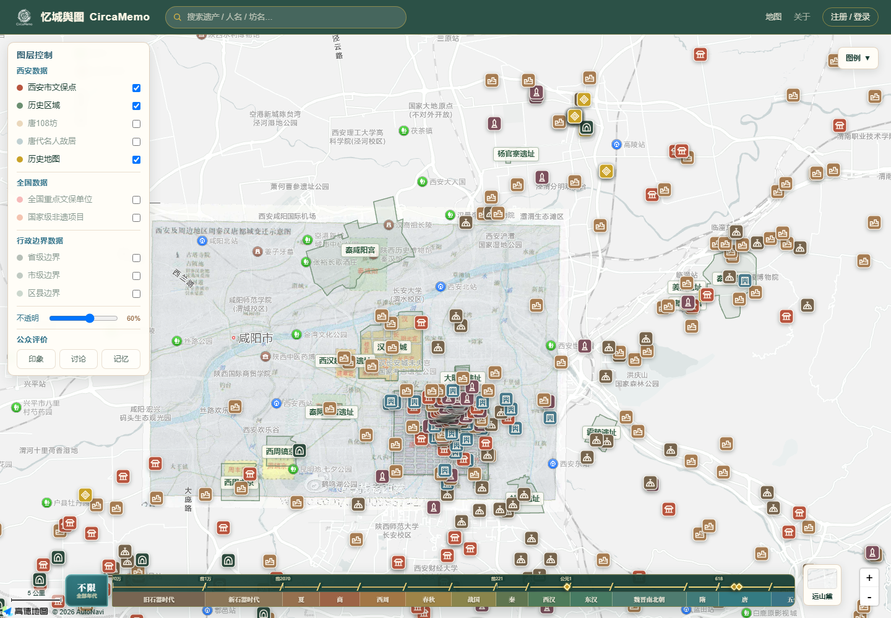

# 忆城舆图 CircaMemo

忆城舆图（CircaMemo）是面向城市历史文化遗产展示、历史空间认知与公共记忆表达的交互式地图。项目包含完整网站源码、九个公开矢量图层，以及数据库初始化脚本。



## 功能

- 高德地图底图、样式切换、地图搜索与图层控制
- 西安文保、全国文保、国家级非遗、唐代名人故居等点图层
- 行政边界、西安历史区域、唐长安 108 坊等面图层
- 历史时间轴与 GeoServer 历史地图叠加
- 公众印象词云、讨论内容与城市记忆相册
- 用户注册登录、文保点记录录入与管理后台

## 技术栈

- Next.js 16、React 19、TypeScript
- 高德地图 JS API 2.0
- PostgreSQL 与 PostGIS
- GeoServer WMS（历史地图）

## 目录

```text
CircaMemo/
├── frontend/          # Next.js 网站与运行必需静态资源
├── data/              # 九个精简 GeoJSON 图层
├── scripts/           # 数据导入脚本
├── sql/               # 数据库初始化脚本
└── docs/              # 数据说明与项目截图
```

## 本地运行

### 1. 准备环境

- Node.js 20 或更高版本
- PostgreSQL 与 PostGIS
- Python 3，用于首次导入数据
- 高德地图 Web JS API Key 与 Security Code

### 2. 安装依赖

```bash
npm install --prefix frontend
```

### 3. 初始化数据库

创建你自己的数据库，然后执行以下命令，并将 `YOUR_DATABASE_NAME` 替换为实际数据库名：

```bash
psql -d YOUR_DATABASE_NAME -f sql/00_init.sql
```

`00_init.sql` 会启用 PostGIS 并创建 `app` schema，需要具有相应权限的数据库账号。

### 4. 配置环境变量

参考 `frontend/.env.example`，在 `frontend/` 下创建 `.env.local`：

```env
POSTGRES_HOST=localhost
POSTGRES_PORT=你的数据库端口
POSTGRES_DB=你的数据库名
POSTGRES_USER=你的数据库用户
POSTGRES_PASSWORD=你的数据库密码

NEXT_PUBLIC_AMAP_KEY=你的高德Key
NEXT_PUBLIC_AMAP_SECURITY_CODE=你的高德SecurityCode
NEXT_PUBLIC_IMG_BASE_URL=你的图片服务基础地址
GEOSERVER_WMS_URL=你的GeoServerWMS接口地址
```

`.env.local` 包含私有配置，不应提交到 Git。

### 5. 导入地图数据和用户表

```bash
python -m pip install psycopg2-binary
python scripts/import_geojson.py
psql -d YOUR_DATABASE_NAME -f sql/01_user_accounts.sql
```

导入脚本面向空数据库；已经存在的图层表会跳过，不会被覆盖。九张图层表与字段说明见 [docs/data.md](docs/data.md)。

### 6. 启动网站

```bash
npm run dev
```

启动后访问终端实际输出的本地地址，端口以启动日志为准。

生产构建与启动：

```bash
npm run build
npm run start
```

## 数据下载

公开数据位于 [data/](data/)，也可直接在 GitHub 浏览：

https://github.com/shikiii7/CircaMemo/tree/main/data

数据仅保留当前网站 API、地图绘制、搜索、筛选与交互所需字段。所有 GeoJSON 使用 WGS 84（EPSG:4326）坐标。字段清单见 [docs/data.md](docs/data.md)。

## 外部服务

- 地图底图需要部署者自己的高德地图 Key 与 Security Code。
- 遗产与非遗封面由部署者自行准备，并通过 `NEXT_PUBLIC_IMG_BASE_URL` 配置图片服务基础地址；公开数据中的 `cover_image_key` 是相对于该地址的资源路径。
- 历史地图需要部署者自己的 GeoServer WMS，并通过 `GEOSERVER_WMS_URL` 配置接口。`frontend/public/data/map-metadata.json` 使用本站 `/api/geoserver-wms` 代理，图层名需与部署者的服务一致；未配置接口时历史地图不可用，其他地图功能不受影响。
- 用户上传图片默认保存在 `data/uploads/user-content/`，可通过 `USER_UPLOAD_DIR` 修改。备份用户数据时应同时备份数据库和该目录。
- 城市记忆相册的 JSON 内容与 20 张派生 WebP 图片均包含在仓库中，无需另行恢复即可使用。

## 许可证

网站源码采用 [MIT License](LICENSE)。第三方地图、图片及数据的原始来源和适用条款仍归各权利方所有；使用或再分发相关数据时，请同时遵守其原始条款。
